<!--
  Profile README for github.com/0xJarmenKell
  Every panel is an SVG in /assets, generated by /scripts/build_assets.py.
  assets/stats.svg is re-rendered daily by .github/workflows/profile-stats.yml.
-->

  <a href="https://0xjarmenkell.github.io/Portfolio/"></a>

  
  <a href="https://yousrycv.netlify.app/"></a>
  
  
  

 

  <a href="https://yousrycv.netlify.app/"></a>

 

  <a href="https://0xjarmenkell.github.io/Portfolio/"></a>

 

  <a href="https://github.com/0xJarmenKell?tab=repositories&type=source"></a>

 

  <a href="https://github.com/0xJarmenKell?tab=repositories&type=source"></a>

  <a href="https://github.com/0xJarmenKell/Devhouse-website"></a>
  <a href="https://github.com/0xJarmenKell/wptique-marketplace"></a>
  <a href="https://github.com/0xJarmenKell/Digital-Bond"></a>
  <a href="https://github.com/0xJarmenKell/maids.cc-tech"></a>
  <a href="https://github.com/0xJarmenKell/Client-Management-System"></a>
  <a href="https://github.com/0xJarmenKell/Offensive_Nim"></a>

 

  <a href="https://github.com/0xJarmenKell"></a>

 

  <a href="mailto:youssefyousry994@gmail.com"></a>

  Every panel on this page is hand-built SVG, generated by <a href="./scripts">a small Python toolkit</a> and refreshed daily by GitHub Actions.

